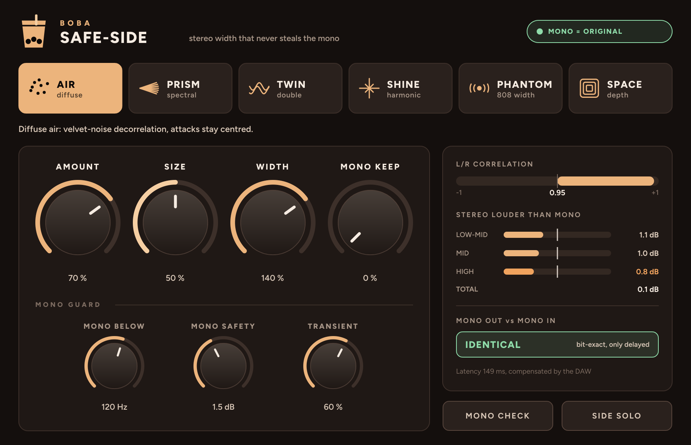
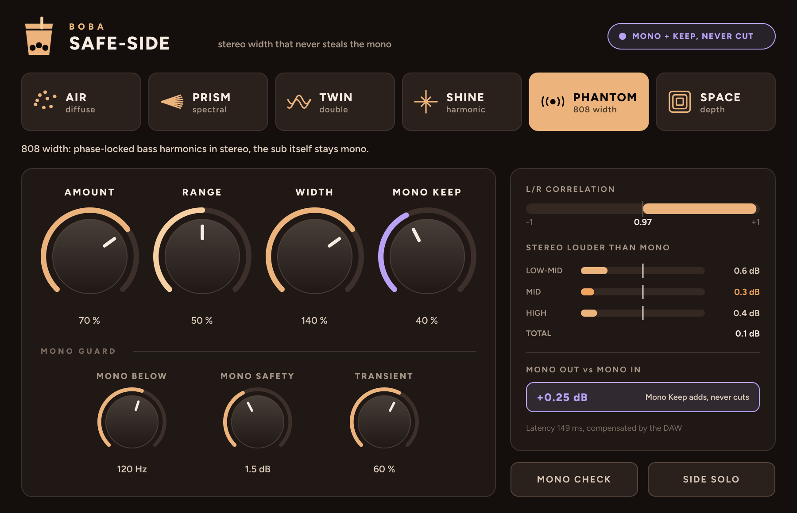
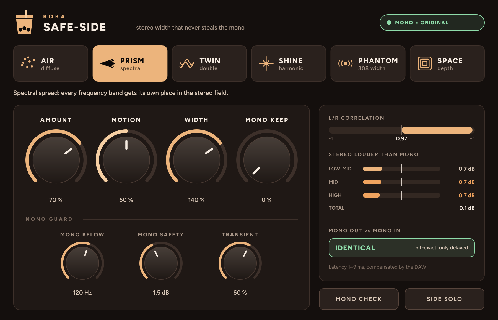

# SAFE-SIDE

**BOBA** · стереорасширитель, который не крадёт моно

Шесть характеров ширины — **AIR, PRISM, TWIN, SHINE, PHANTOM, SPACE** — и одно правило: вся ширина живёт только в боках, поэтому моно на выходе в точности равно моно на входе. Трек звучит широко в наушниках и не проваливается на телефоне, в клубе и в TikTok.
VST3 + AU для macOS (Apple Silicon и Intel), VST3 для Windows.



## Скачать

Готовые сборки лежат на странице **[Releases](../../releases)**:
- **Mac** (Apple Silicon + Intel, VST3 + AU): `BOBA-SafeSide-<версия>-Mac-Installer.pkg` — двойной клик → Продолжить → Установить. Если macOS не даёт открыть: правый клик → Открыть (на macOS 15+: Настройки → Конфиденциальность и безопасность → «Всё равно открыть»).
- **Windows** (VST3): `BOBA-SafeSide-<версия>-Windows-Setup.exe` — Далее → Установить. Если SmartScreen предупреждает: «Подробнее» → «Выполнить в любом случае».
- Zip-архивы — тот же плагин для ручной установки (`install_mac.command` / копирование в `C:\Program Files\Common Files\VST3`).

Потом пересканируй плагины в DAW — SAFE-SIDE появится у производителя **BOBA**. Полное руководство — [docs/MANUAL.md](docs/MANUAL.md).

## Что умеет

- **AIR** — мягкая диффузная ширина (декорреляция бархатным шумом), атаки остаются в центре.
- **PRISM** — раскладывает звук по частотам: соседние полосы уходят в разные стороны, можно пустить их медленно плыть.
- **TWIN** — дабл: два голоса плавают по времени, как плёнка.
- **SHINE** — новые верхние гармоники: чётные слева, нечётные справа.
- **PHANTOM** — ширина 808: саб остаётся в моно, его гармоники разлетаются по сторонам и привязаны по фазе к тем, что уже звучат.
- **SPACE** — ранние отражения комнаты для глубины без ревёрберного хвоста.
- **AMOUNT / COLOR** — сколько и какой ширины (COLOR у каждого характера свой: SIZE, MOTION, DRIFT, TONE, RANGE, ROOM).
- **WIDTH** — усилить или сузить стерео, которое уже есть в треке (0–200 %).
- **MONO KEEP** — подмешать часть ширины и в моно, чтобы трек был плотнее на телефоне. Подмешивается только то, что не может погасить звук, и каждая добавка проверяется по полосам и во времени: она может только прибавить.
- **Mono Guard** — **MONO BELOW** (саб и 808 в моно), **MONO SAFETY** (стерео не громче моно больше чем на 1,5 дБ в каждой полосе), **TRANSIENT** (атаки сухие).
- **Панель проверки** — корреляция, «стерео громче моно» по полосам и живое сравнение моно на выходе со входом: **IDENTICAL**.
- **MONO CHECK / SIDE SOLO**, подсказки на русском (наведи мышь на ручку).

| PHANTOM + MONO KEEP | PRISM |
|---|---|
|  |  |

## Проверено цифрами

На тестовом бите 140 BPM (808, бочка, хэты, пэд, плак, вокал):

| | SAFE-SIDE, MONO KEEP 0 | SAFE-SIDE, MONO KEEP 100 % | Haas 12 мс |
|---|---|---|---|
| Моно выход vs вход | совпадает (−327 дБ, числовой шум) | только прибавляет, до +0,7 дБ | меняется |
| Худшая частота в моно | 0,00 дБ | 0,00 дБ | −19,7 дБ |
| Худший момент в моно (громкие места) | 0,00 дБ | 0,00 дБ (соло-808 в PHANTOM: −0,3) | −16 дБ |
| Стерео громче моно, по полосам | ≤ 1,5 дБ | ≤ 1,5 дБ | 5,2 дБ |

Задержка около 150 мс, DAW компенсирует её автоматически.

## Сборка из исходников

Каждый push в `main` собирает плагин в GitHub Actions (Mac + Windows), прогоняет тест моно-контракта, собирает установщики и публикует релиз.

Локально на Mac: `bash build_mac.sh` (поставит cmake, скачает JUCE, соберёт и установит).

Тест моно-контракта без JUCE (Linux/Mac/Windows):
```
cmake -B build -DSS_ONLY_TESTS=ON && cmake --build build
./build/SafeSideContractTest
```

## Устройство кода

- `Source/dsp/Engine.h` — движок: M/S, шесть характеров, MONO KEEP, Mono Guard, Width.
- `Source/dsp/Analyzer.h` — потоковый анализ середины: тональное / атаки / шум (STFT, медианные фильтры), PRISM.
- `Source/dsp/Projector.h` — проекция «никогда не вычитать» для MONO KEEP (три сдвинутые сетки).
- `Source/dsp/Characters.h`, `Kernels.h`, `Basics.h` — характеры, ядра декорреляции и отражений, фильтры, FFT.
- `Source/PluginProcessor.*` — параметры, задержка, bypass с той же задержкой, сохранение.
- `Source/PluginEditor.*`, `Theme.h`, `Tooltips.h` — интерфейс BOBA и подсказки.
- `tests/contract_test.cpp` — проверка моно-контракта, `tests/render.cpp` — офлайн-рендер, `tests/host_test.cpp` — загрузка VST3 как в DAW.

Построено на JUCE 8 (AGPLv3 / коммерческая лицензия). Шрифт Figtree — SIL Open Font License.
