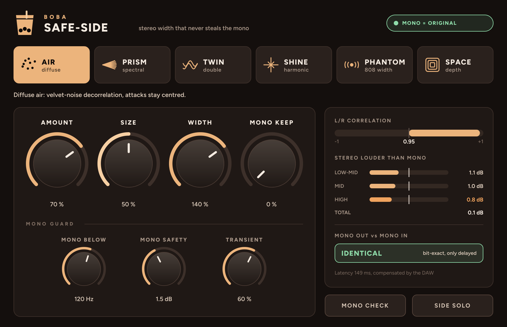

# SAFE-SIDE — руководство

**BOBA · SAFE-SIDE** — стереорасширитель, который не крадёт моно. Обычные расширители (Haas, задержки, хорусы, L/R-декорреляторы) делают трек шире, но при сложении в моно (телефон, клуб, Bluetooth-колонка, TikTok) часть звука гасится: проваливаются вокал, синты, 808. SAFE-SIDE устроен так, что этого не происходит.

## Главное правило

Сигнал делится на середину и бока: `M = (L+R)/2`, `S = (L−R)/2`. Вся ширина, которую добавляет плагин, живёт **только в боках**. На выходе `L' = M + S'`, `R' = M − S'`, а значит `(L'+R')/2 = M`: моно на выходе — это ровно моно на входе, что бы ни происходило с боками. Плагин это не только обещает, но и показывает: в правой панели надпись **IDENTICAL** значит, что моно на выходе совпадает с входом бит в бит.

Единственная ручка, которая трогает середину, — **MONO KEEP** (см. ниже). Даже она ничего не вычитает.

## Шесть характеров

| Характер | Что делает | COLOR означает | Где хорош |
|---|---|---|---|
| **AIR** | Мягкая диффузная ширина: декорреляция «бархатным шумом», атаки остаются в центре | **SIZE** — размер облака (15–60 мс) | Пэды, вокал, мелодии, мастер |
| **PRISM** | Раскладывает звук по частотам: соседние полосы уходят в разные стороны | **MOTION** — 0 стоит на месте, дальше полосы медленно плывут | Синты, плаки, аккорды |
| **TWIN** | Дабл: два голоса чуть плавают по времени, как плёнка | **DRIFT** — от плотного дабла до живого хоруса | Вокал, гитары, лиды |
| **SHINE** | Новые верхние гармоники: чётные слева, нечётные справа | **TONE** — откуда начинается блеск (2–6 кГц) | Вокал, хэты, мастер |
| **PHANTOM** | Ширина 808: саб в моно, его гармоники в стерео (2-я по центру, нечётные слева, чётные справа) | **RANGE** — до какой частоты искать основной тон (70–200 Гц) | 808, бас, рейдж-беты |
| **SPACE** | Ранние отражения комнаты, разные слева и справа | **ROOM** — размер комнаты | Сухие записи, лиды, перкуссия |

Переключение характеров идёт плавным кроссфейдом, без щелчков; можно автоматизировать.

## Ручки

- **AMOUNT** — сколько ширины добавляет характер. Работает и на чистом моно-звуке.
- **COLOR** — главный «тембр» характера (подпись меняется: SIZE, MOTION, DRIFT, TONE, RANGE, ROOM).
- **WIDTH** — исходная ширина трека: 100 % — как было, 0 % — моно, 200 % — вдвое шире. Сужение работает всегда, расширение придерживает Mono Guard.
- **MONO KEEP** — подмешать часть ширины и в середину, чтобы трек был плотнее и в моно. Подмешивается только материал, который не может погасить звук:
  - шумовые хвосты (дыхание, реверб, шипение, шум хэтов) через медленно вращающуюся декорреляцию — у них нет стабильных частот, поэтому нет и постоянных провалов;
  - новые гармоники PHANTOM и SHINE, привязанные по фазе к тем, что уже звучат.
  
  Затем каждая добавка проверяется в каждой частотной полосе и в каждый момент (на трёх сдвинутых сетках анализа) и разворачивается так, чтобы она могла только прибавить, но не вычесть. При 0 % моно на выходе в точности равно моно на входе.

### MONO GUARD

- **MONO BELOW** — всё ниже этой частоты остаётся в моно (саб, 808, бочка). Обычно 100–150 Гц.
- **MONO SAFETY** — насколько стерео может быть громче моно в каждой из трёх полос (до 1 кГц, 1–5 кГц, выше 5 кГц). По умолчанию 1,5 дБ. Дополнительно держится корреляция L/R не ниже 0,25. Mono Guard работает сам: если ширины слишком много, он мягко её придерживает (полоса в панели становится оранжевой).
- **TRANSIENT** — сколько атак оставить сухими и в центре, чтобы барабаны не теряли удар.

### Кнопки

- **MONO CHECK** — послушать в моно.
- **SIDE SOLO** — послушать только бока.

## Панель проверки

- **L/R CORRELATION** — корреляция каналов. Выше нуля — всё хорошо.
- **STEREO LOUDER THAN MONO** — насколько стерео громче моно в каждой полосе; белая черта — предел MONO SAFETY.
- **MONO OUT vs MONO IN** — живое сравнение: **IDENTICAL** (бит в бит) при MONO KEEP = 0 или «+x dB, never cuts», если KEEP добавляет плотности в моно.

## Задержка

SAFE-SIDE заглядывает вперёд, чтобы отличить тональные звуки от шума и атак: задержка около **150 мс** (на 44,1 кГц — около 160 мс). Ableton, Logic, FL Studio и другие DAW компенсируют её автоматически: на дорожках всё остаётся синхронно. Для живой игры через плагин в реальном времени он не подходит — это инструмент сведения и мастеринга. Bypass сохраняет ту же задержку, так что включение и выключение не сдвигает дорожку.

## Цифры (проверка на тестовом бите 140 BPM: 808, бочка, хэты, пэд, плак, вокал)

| | MONO KEEP = 0 | MONO KEEP = 100 % |
|---|---|---|
| Моно выход vs вход (все 6 характеров) | совпадает до −327 дБ (числовой шум) | только прибавляет: до +0,7 дБ |
| Худший момент в моно, громкие места, полный бит | 0,00 дБ | 0,00 дБ |
| Худший момент, соло-808, PHANTOM | 0,00 дБ | −0,3 дБ |
| Стерео громче моно, по полосам, даже при WIDTH 200 % | ≤ 1,5 дБ | ≤ 1,5 дБ |

Для сравнения, классический Haas 12 мс на том же бите: отдельные частоты в моно проваливаются на −19,7 дБ, худший момент −16 дБ, стерео громче моно на 5,2 дБ.

Эти проверки (`tests/contract_test.cpp`) запускаются при каждой сборке в GitHub Actions на Mac и Windows: если моно хоть где-то перестанет совпадать, сборка упадёт.
